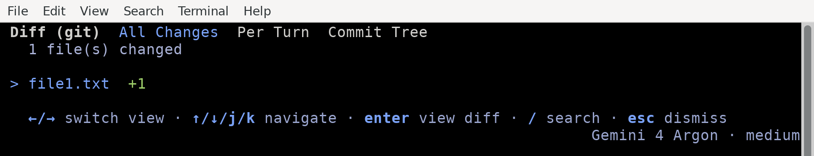
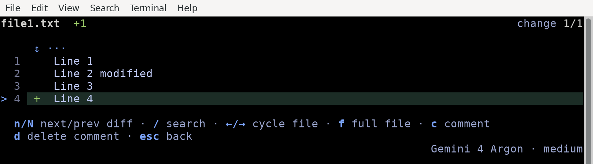
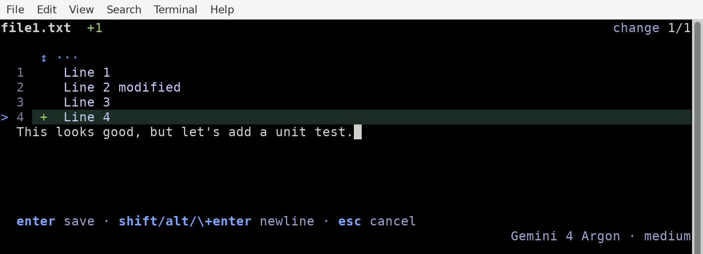
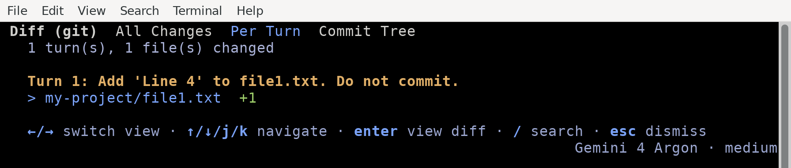
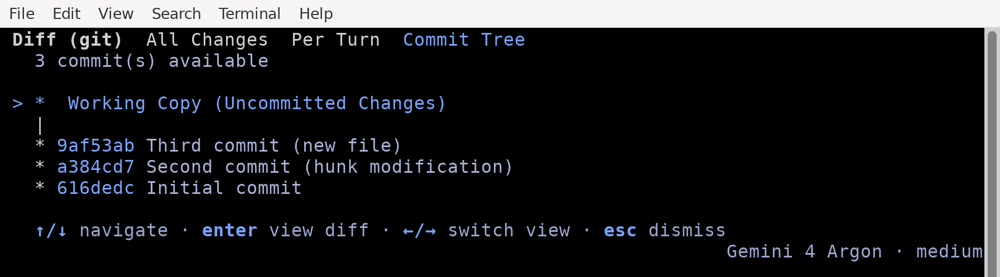
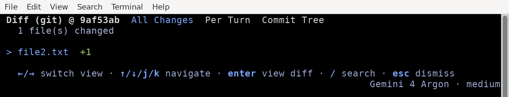

# Diff command (/diff)

Available on: Antigravity CLI

View and review workspace changes, commit history, and agent turn diffs interactively within the TUI.

Note

The `/diff` command is for the Antigravity CLI. To review diffs, comment on lines, and commit changes in the Antigravity App, see [Review changes](https://antigravity.google/docs/review-changes).

## Overview

The `/diff` command opens the **Interactive Diff Viewer**, a full-screen panel that allows you to inspect changes in your workspace and conversation history. It has three views (**All Changes**, **Per Turn**, and **Commit Tree**) and provides an interactive review workflow where you can add line-by-line comments to steer the agent’s next steps.

## Interactive diff viewer panels

To open the diff viewer, follow these steps:

1.  Type `/diff` in the prompt box.
2.  Press Enter.

```text
/diff
```

### Navigation and controls

The diff viewer has three views, which you can switch between with ← / → (or Tab):

*   **All Changes**: Shows a list of all modified and untracked files in your active workspace:
    *   Supports Git, Mercurial (Hg), and Jujutsu (JJ) automatically.
    *   Use ↑/↓ to navigate the file list, and Enter to open the detail view.
*   **Per Turn**: Shows the changes introduced by the agent in each turn of the current conversation:
    *   Useful for reviewing the agent’s work step-by-step.
    *   Use ↑/↓ to navigate, and Enter to view details.
*   **Commit Tree**: Renders an interactive commit graph/tree of your repository:
    *   Use ↑/↓ to navigate the commit chain.
    *   Press Enter to list the files that the selected commit changed in the **All Changes** view.

* * *

## Step-by-step walkthrough

Here is how to use the diff viewer to review changes, add comments, and steer the agent.

### Reviewing workspace changes (All Changes view)

When you run `/diff`, it opens in the **All Changes** view, which lists modified and untracked files (or shows **No uncommitted changes** if there aren’t any):



Press Enter on a file to open its **Detail View**, which shows the unified diff. To move around the diff:

*   Use ↑/↓ to move the cursor from line to line.
*   Use ←/→ to quickly swap between files without returning to the list.
*   Use N/Shift + N to jump to the next/previous change.



### Adding comments and steering the agent

While in the **Detail View**, you can review the code and write feedback directly onto specific lines:

1.  **Locate the line**: Move the cursor to the line you want to comment on.
2.  **Open the comment input**: Press C. A comment input opens below the line:



3.  **Write your feedback**: Type your feedback and press Enter to save (or Esc to cancel).
4.  **Manage your comments**: Saved comments are marked in the diff. You can delete a comment by highlighting the line and pressing D.
5.  **Exit and submit**: Press Esc to return to the file list. Press Esc again to exit `/diff`. If you have unsent comments, the **Unsent Comments** screen appears:
    *   Press Y to send the comments and exit. Your comments are formatted and sent to the agent as your next prompt, allowing you to steer its next turn.
    *   Press N to exit without sending, discarding the comments.

### Reviewing turn history (Per Turn view)

Press → (or Tab) to switch to the **Per Turn** view. This groups changes by the conversation turn in which they were introduced, allowing you to inspect what the agent did in previous steps:



### Navigating the commit tree (Commit Tree view)

Press → (or Tab) again to switch to the **Commit Tree** view. This renders the repository’s commit history as an interactive graph. Use ↑/↓ to navigate up and down the chain:



Highlight any commit and press Enter to list the files it changed in the **All Changes** view, and then press Enter on a file to review its diff:



* * *

## Keyboard shortcuts reference

### File list view (All Changes and Per Turn views)

| Key | Action |
| :-- | :-- |
| ← / → (or Tab) | Switch views (All Changes > Per Turn > Commit Tree) |
| ↑ / ↓ (or K / J) | Navigate file list |
| Enter | Open selected file’s Detail View |
| / | Search the diffs of all listed files, and then open the first match |
| Esc | Clear the search, or exit Diff Viewer |

### File detail view

| Key | Action |
| :-- | :-- |
| ↑ / ↓ (or K / J) | Move the cursor up or down one line |
| Shift + ↑ / ↓ (or Ctrl + U / Ctrl + D) | Scroll diff by half a page |
| PgUp / PgDn | Scroll diff by page |
| → / ← | Switch to next / previous file |
| N / Shift + N | Jump to next / previous change, or to the next / previous match while a search is active |
| / | Search the diff |
| F | Switch between the changes only and the full file |
| Ctrl + O | Show or hide the unchanged lines folded nearest the cursor |
| C | Add/edit comment on the current line |
| D | Delete comment on the current line |
| Esc | Clear the search, or return to File List View |

### Commit Tree view

| Key | Action |
| :-- | :-- |
| ↑ / ↓ (or K / J) | Navigate commit history |
| ← / → (or Tab) | Switch views |
| Enter | List the files that the selected commit changed in the **All Changes** view |
| Esc | Exit Diff Viewer |

### Unsent Comments screen

| Key | Action |
| :-- | :-- |
| Y | Send comments to the agent and exit |
| N | Exit without sending comments |
| Esc | Return to File List View |

## See also

Explore the following guides to learn more about CLI customization and conversation management:

*   **[Review changes](https://antigravity.google/docs/review-changes?tab=cli)**: Compare `/diff` with the Review pane in the Antigravity App.
*   **[Settings, rendering, and keybindings](https://antigravity.google/docs/cli/settings)**: Customize your TUI theme, alt-screen preferences, and keybindings.
*   **[Conversations](../conversations.md)**: Learn how to manage, fork, and rewind conversation threads.
*   **[CLI reference](../reference.md)**: Quick reference for all slash commands and default shortcuts.