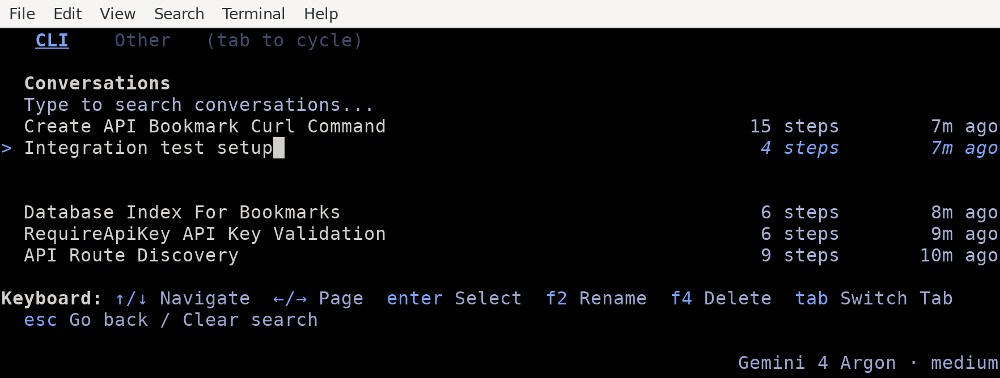
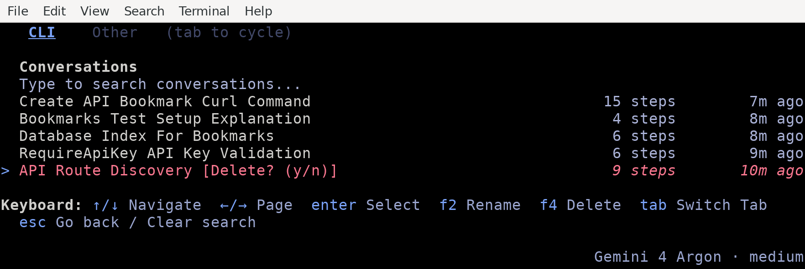
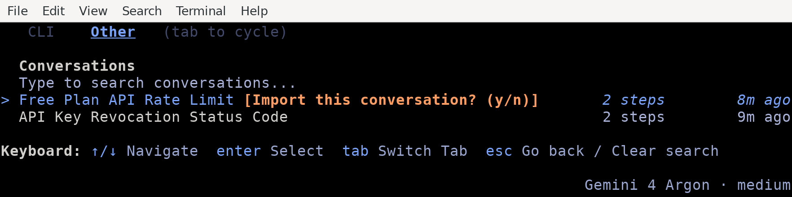

# Resume command (/resume)

Available on: Antigravity CLI

Browse, search, and resume past conversation threads, or recover your last session instantly from the command line.

## Overview

Antigravity CLI allows you to maintain multiple ongoing development threads. The `/resume` command opens an interactive conversation picker TUI panel to browse and load your history. You can also resume sessions directly from your host terminal using command-line flags.

* * *

## Interactive conversation picker

To open the conversation picker inside the TUI, follow these steps:

1.  Type `/resume` (or aliases `/switch`, `/conversation`) in the prompt box.
2.  Press Enter.

```text
/resume
```

### Navigating and searching conversations

The conversation picker displays a list of past conversations sorted by recency (newest first). Use the following controls to interact with the list:

*   **Search**: Start typing to instantly filter conversations by their title, the first line of the first prompt, or conversation ID.
*   **Navigate**: Use ↑/↓ to scroll through the filtered list.
*   **Page**: Use ←/→ to page backward and forward through older history blocks.
*   **Select**: Highlight your target session and press Enter to load it.
*   **Exit**: Press Esc to clear the search. If the search is empty, Esc closes the picker and returns you to the prompt.

The keyboard hints at the bottom of the picker show the available keys:


### Renaming a conversation

To keep your history organized, you can rename conversations directly within the picker:

1.  Use ↑/↓ to highlight the conversation you want to rename.
2.  Press F2. The title becomes an editable field, prefilled with the current title.
3.  Type the new name and press Enter to save, or Esc to cancel.

In the following example, the title of the second conversation is replaced with `Integration test setup`:



### Deleting a conversation

To clean up obsolete threads, follow these steps:

1.  Highlight the target conversation in the list.
2.  Press F4. A `[Delete? (y/n)]` confirmation prompt appears next to the title.
3.  Press Enter (or Y) to confirm deletion, or Esc (or N) to cancel.

For example, pressing F4 on the oldest conversation shows this prompt:



### Importing from the Antigravity App

You can import and resume active threads initiated in the Antigravity App:

1.  With the conversation picker open, press Tab to switch from the **CLI** tab to the **Other** tab.
2.  Highlight the desktop conversation you want to import.
3.  Press Enter. A confirmation prompt `[Import this conversation? (y/n)]` appears.
4.  Press Enter (or Y) to confirm. The CLI clones the history, context, and tool trajectories into your terminal session.

The **Other** tab lists the conversations that you started in the Antigravity App:



* * *

## Command-line shortcuts

You can bypass the TUI picker and resume sessions directly when launching `agy` from your host shell.

### Quick resume last session (`-c` / `--continue`)

To instantly resume the single most recent conversation associated with your active workspace, run the following command:

```bash
agy -c
```

_(Alternative: `agy --continue`)_

### Resume specific session (`--conversation`)

To load a specific conversation directly by its unique ID, run the following command:

```bash
agy --conversation <conversation-id>
```

* * *

## Under the hood: the session cache

When you use the `-c` / `--continue` flag, the CLI resolves the target session using a local workspace-keyed cache.

### The cache file

The session cache file has the following properties:

*   **Location**: `~/.gemini/antigravity-cli/cache/last_conversations.json`
*   **Format**: A JSON map associating absolute workspace directory paths with their most recently active conversation ID:
    
    ```json
    {
        "/usr/local/google/home/username/Develop/my-project": "a1b2c3d4-e5f6-7890-abcd-ef1234567890",
        "/usr/local/google/home/username/Develop/another-repo": "f9e8d7c6-b5a4-3210-fedc-ba9876543210"
    }
    ```
    

### Resolution workflow

The CLI resolves the session in the following sequence:

1.  **Launch**: You run `agy -c` from `/path/to/workspace`.
2.  **Lookup**: The CLI reads `last_conversations.json` and looks up the key `/path/to/workspace`.
3.  **Verification**: If an ID is found, the CLI queries the backend to verify the conversation still exists.
4.  **Load**: Loads the appropriate session:
    *   If verified, it loads the session.
    *   If the conversation was deleted or the key is missing, it starts a fresh session for that workspace.

* * *

## See also

Explore the following guides to learn more about managing sessions and settings:

*   **[Managing conversations](../conversations.md)**: Learn about workspace scoping and branching with `/fork`.
*   **[CLI reference](../reference.md)**: View all available slash commands and default keybindings.
*   **[Settings, rendering, and keybindings](https://antigravity.google/docs/cli/settings)**: Configure rendering modes and customize keyboard shortcuts.