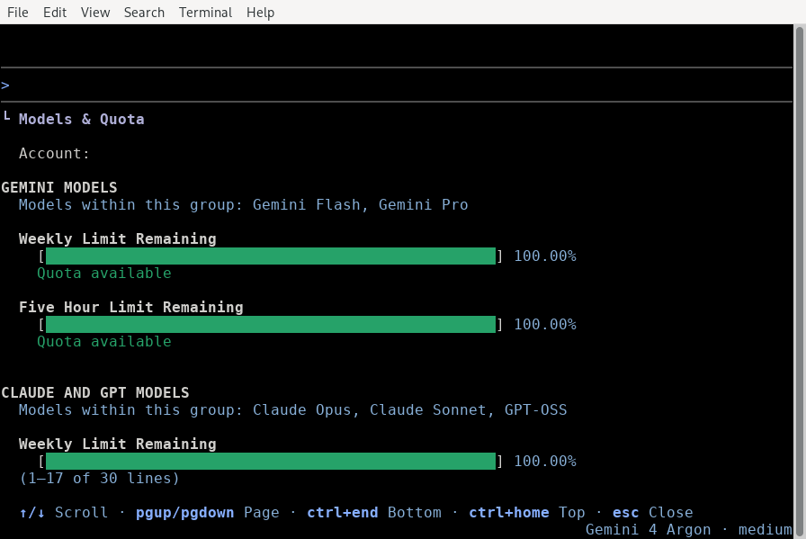

# Model quotas (/usage)

Available on: Antigravity CLI

View your active model quota usage and refresh your configuration.

## Overview

Antigravity CLI provides the `/usage` command (alias `/quota`) to help you monitor your resource consumption. When run, the command refreshes your model configuration and quota status from the backend and opens an interactive TUI panel.

## Viewing your usage

To open the **Models & Quota** panel, follow these steps:

1.  Type `/usage` (or `/quota`) in the prompt box.
2.  Press Enter.

```text
/usage
```



### Interactive panel features

The panel displays the following details:

*   **Model quotas**: Your remaining quota for each model group, such as Gemini models (Gemini Flash and Gemini Pro) and Claude and GPT models. The models in a group share a weekly limit and a five-hour limit.
*   **Active refresh**: The CLI automatically triggers a fresh check of your quotas on disk and from the backend service when you open this panel.

### Navigation controls

Use the following keyboard shortcuts to navigate the panel:

| Key | Action |
| :-- | :-- |
| ↑ / ↓ (or J / K) | Scroll up or down by one line. |
| PgUp / PgDn | Scroll up or down by one page. |
| G / Shift + G | Jump to the top or bottom of the list. |
| Esc (or Q) | Close the panel and return to the prompt. |

## Next steps

Explore the following guides to learn more about CLI commands and settings:

*   **[CLI reference](../reference.md)**: View all available slash commands and keybindings.
*   **[Settings, rendering, and keybindings](https://antigravity.google/docs/cli/settings)**: Configure your default models and credit usage preferences.