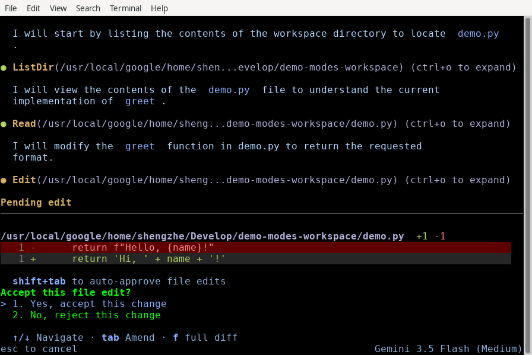
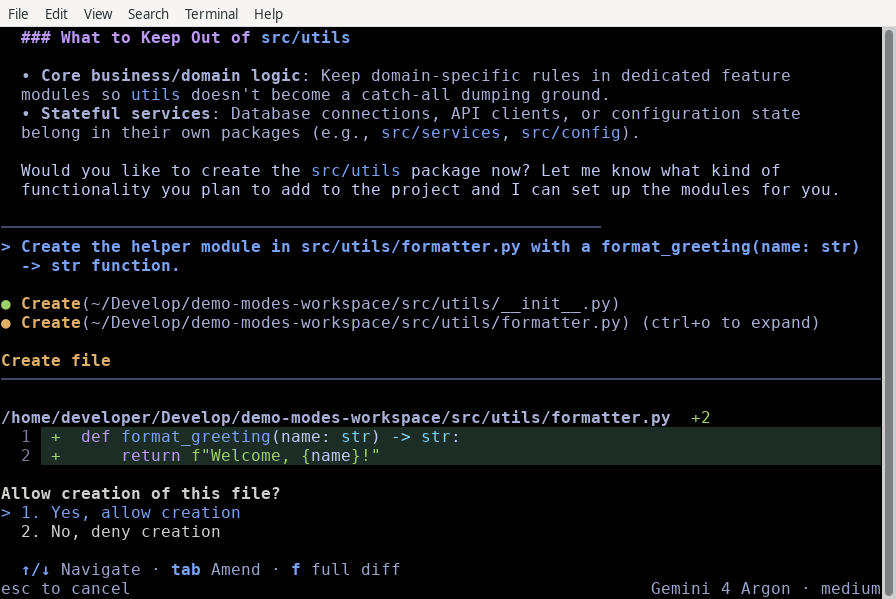
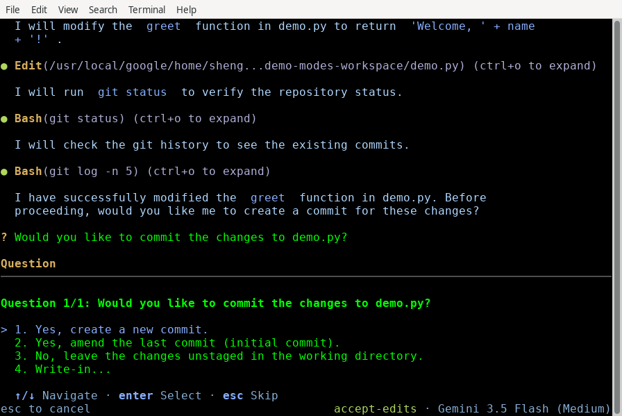
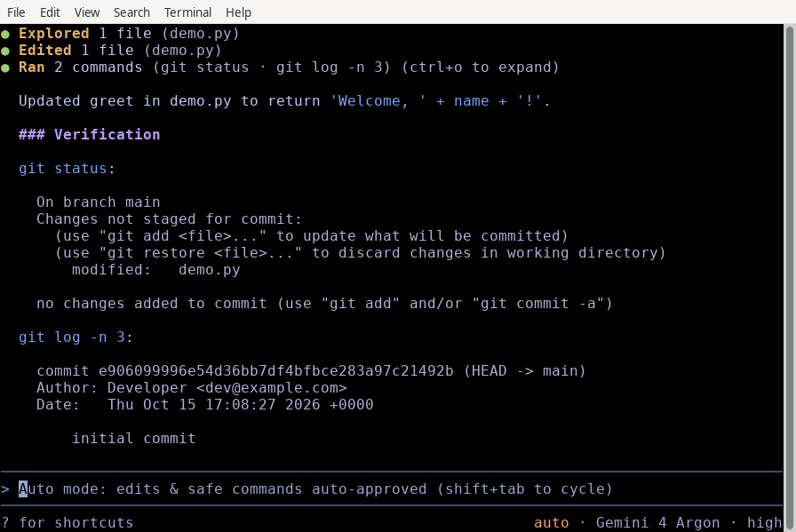
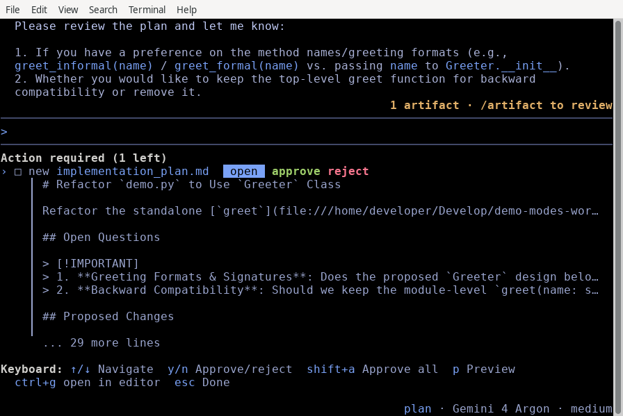
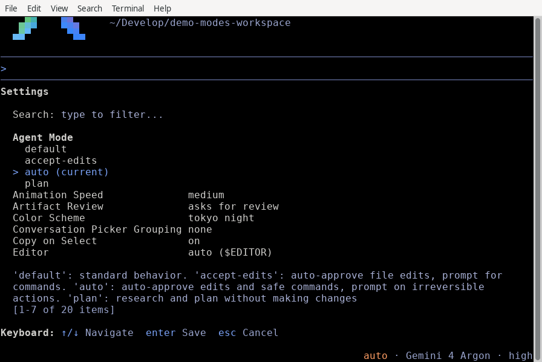

# Choose an execution mode

Available on: Antigravity CLI

Control whether Antigravity CLI pauses to ask before modifying files or executing commands during a session.

## Before you begin

Make sure you meet the following prerequisites:

*   [Install Antigravity CLI](https://antigravity.google/docs/cli/install).
*   Have an active project repository with source code to edit.

## Available modes

Each execution mode makes a different tradeoff between conversational autonomy and developer oversight. The following table shows how Antigravity CLI handles file operations, command execution, and planning in each mode:

| Mode | Behavior | Best for |
| :-- | :-- | :-- |
| `default` | Pauses for interactive diff review before modifying or creating files, and asks before running terminal commands. | Standard development, reviewing sensitive code changes, and careful refactoring. |
| `accept-edits` | Automatically approves file creations and edits inside your workspace, but still asks before running terminal commands. | Rapid prototyping, iterating on trusted code, and reducing file-edit interruptions. |
| `auto` (Preview) | Automatically approves workspace file edits, runs terminal commands in the sandbox by default, and automatically evaluates commands outside the sandbox so safe, reversible commands run without prompting. Available in `v1.3.5+` on macOS and Linux and `v1.4.4+` on Windows; requires the terminal sandbox. | Autonomous workflows where safe edits and commands proceed without interruption while irreversible actions still prompt for confirmation. |
| `plan` | Prepends the `/plan` instruction prefix to analyze and outline steps before writing code. | Exploring unfamiliar architecture or designing complex multi-step features. |

Note

Explicit allow, ask, and deny rules configured using `/permissions`, along with global overrides such as `--dangerously-skip-permissions` (`always-proceed`) or `strict` tool permissions, continue to take precedence across all execution modes.

## Cycle execution modes during a session

You can switch execution modes mid-session without interrupting active tasks or restarting the terminal:

1.  Press Shift + Tab inside the prompt box to cycle through the active sequence: `default` > `accept-edits` > `auto` > `plan` > `default`. Where `auto` mode isn’t available, cycling skips directly from `accept-edits` to `plan`.
2.  Observe the mode indicator in the bottom-right status bar (`accept-edits`, `auto`, or `plan`) and the prompt placeholder hint (such as `Auto mode: edits & safe commands auto-approved (shift+tab to cycle)`) to confirm your active mode.

Tip

When Antigravity CLI pauses for a pending file edit confirmation in `default` mode, you can press Shift + Tab to switch to `accept-edits` or `auto` mode and automatically approve pending workspace file modifications, including queued subagent file writes.

## Review modifications in default mode

In `default` mode (`request-review`), Antigravity CLI pauses before applying any file writes to disk and renders an inline, syntax-highlighted diff preview.

```bash
# Launch in default interactive review mode
agy
```

The following example shows a pending file edit, with the diff and the prompt to accept or reject it:



When Antigravity CLI asks **Accept this file edit?**, you can take any of the following actions:

*   Press 1, or highlight **Yes, accept this change** and press Enter, to save the change to disk.
*   Press 2, or highlight **No, reject this change** and press Enter, to keep the existing file unchanged.
*   To reject the edit and tell the agent what to do differently, highlight **No, reject this change**, press Tab, type your instructions, and press Enter.
*   Press f to open a full-screen, scrollable diff review with three context lines and hunk separators.

A pending file edit stays open until you accept or reject it. Pressing Esc doesn’t dismiss it.

### New file creation previews

When Antigravity CLI creates a new file, the confirmation panel shows a **Create file** header, the file path (for example, `src/utils/formatter.py`), and an addition-only diff preview, followed by this prompt:

```text
Allow creation of this file?
> 1. Yes, allow creation
  2. No, deny creation
```

If the file is outside your workspace, the panel also shows `Reason: outside workspace` and adds **Yes, and always allow non-workspace access** as the second choice.

The following example shows the **Create file** panel for a new file, `src/utils/formatter.py`:



As with file edits, press f to open the full diff, or highlight **No, deny creation** and press Tab to tell the agent what to do differently. Pressing Esc denies the file creation.

## Auto-approve edits with accept-edits mode

Select `accept-edits` mode when you want Antigravity CLI to work in longer, uninterrupted stretches across your filesystem without pausing for each file modification.

```bash
# Launch directly in accept-edits mode
agy --mode=accept-edits
```

In this mode, all standard file creations, edits, and replacements inside your workspace run automatically. Subagents spawned during the session also inherit the `accept-edits` setting, preventing background file writes from queueing for manual approval.

When `accept-edits` mode is active, the bottom-right status bar shows `accept-edits`:



## Automatically evaluate commands with auto mode

`auto` mode extends `accept-edits` to terminal command execution so routine development tasks proceed without manual confirmation prompts.

Note

`auto` mode is in Preview and available in Antigravity CLI `v1.3.5+` on macOS and Linux and `v1.4.4+` on Windows. It isn’t currently available for business or enterprise accounts, including [Antigravity in Gemini Enterprise](https://antigravity.google/docs/enterprise). If `auto` mode isn’t available for your account or platform, the CLI starts in `default` mode, and `auto` doesn’t appear in Shift + Tab cycling or `/config`.

```bash
# Launch directly in auto mode
agy --mode=auto
```

When `auto` mode is active:

*   **Workspace file edits**: File creations and modifications inside your active workspace are approved automatically, including pending writes from background subagents.
*   **Sandboxed execution by default**: Terminal commands run inside the native OS terminal sandbox (`sandbox-exec` on macOS, kernel namespaces on Linux, process security environments on Windows) by default.
*   **Automatic safety evaluation for commands outside the sandbox**: Any command that needs to run outside the terminal sandbox is automatically evaluated before execution. Safe, reversible commands (such as workspace build, test, lint, and format commands) run automatically without asking for approval, while irreversible or high-risk actions still pause and prompt for your confirmation.

The bottom-right status bar shows `auto`, and the prompt input box shows `Auto mode: edits & safe commands auto-approved (shift+tab to cycle)`:



### Requirements and limitations

`auto` mode requires the [terminal sandbox](https://antigravity.google/docs/sandbox):

*   On Windows, the sandbox requires Windows 11 24H2 or later with the August 2026 update or later.
*   Starting in `v1.4.4`, if the sandbox isn’t available on your machine—for example, on Windows 10, earlier Windows 11 builds, or Linux hosts and some containers that block unprivileged user namespaces—`auto` mode isn’t offered.

In [headless mode](./headless.md), if `auto` mode isn’t available, `--mode=auto` prints a warning and continues in `default` mode.

## Analyze tasks before editing with plan mode

Use `plan` mode when taking on complex refactoring, multi-file architectural changes, or unfamiliar codebase investigations.

```bash
# Launch directly in planning mode
agy --mode=plan
```

When `plan` mode is active through Shift + Tab cycling or the `--mode` flag, the CLI automatically prepends the `/plan` instruction prefix to your prompts. The agent investigates relevant files using read-only search and file-viewing tools and presents a structured execution outline for your approval before writing code.

The bottom-right status bar shows `plan` while the mode is active:



## Persist or override your default mode

You can set your preferred startup execution mode permanently across sessions or override it for specific invocations.

### Using the interactive settings panel

To inspect or update your default mode mid-session:

1.  Open the interactive settings panel:
    
    ```bash
    /config
    ```
    
2.  Highlight **Agent Mode** with ↑/↓.
    
3.  Press ←/→ to change it, or press Enter to open the list of modes, where the current mode is marked `(current)`:
    
    
    
    Highlight a mode and press Enter. Either way, the change is written to `settings.json` and applies to your session immediately.
    
4.  Press Esc to close the panel.
    

### Setting `agentMode` in `settings.json`

Set `agentMode` directly inside your user or project configuration file (`"accept-edits"`, `"auto"`, or `"plan"`, or omit/`""` for `default`):

```json
{
    "agentMode": "auto"
}
```

The CLI loads this file from `~/.gemini/antigravity-cli/settings.json` at startup and applies your chosen baseline execution mode.

### Command-line flag overrides

Pass the `--mode` flag (`accept-edits`, `auto`, or `plan`) to temporarily override your persistent default mode for a single terminal run:

```bash
# Override settings.json to run in auto mode or planning mode
agy --mode=auto
agy --mode=plan
```

## Common mistakes

| Mistake | Why it fails | Fix |
| :-- | :-- | :-- |
| Expecting `sandbox` in Shift + Tab cycling | `sandbox` is an OS containment permission setting, not an execution mode (`auto` mode enables the terminal sandbox automatically) | Use `--mode=auto`, pass `--sandbox`, or enable **Sandbox Mode** in `/config` |
| Using legacy `/planning` or `/fast` commands | These vestigial commands were removed in `1.1.0` | Press Shift + Tab to cycle modes or type `/plan` before your prompt |
| Passing `--permission-mode` | `agy` uses `--mode` (`--mode=accept-edits`, `--mode=auto`, or `--mode=plan`) for execution overrides | Run `agy --mode=accept-edits`, `agy --mode=auto`, or check `agy --help` |

## Next steps

Explore the following guides to further customize your CLI workflow:

*   **[Permissions](https://antigravity.google/docs/cli/permissions)**: Configure fine-grained tool approval rules and wildcard matching.
*   **[Settings, rendering, and keybindings](https://antigravity.google/docs/cli/settings)**: Customize configuration overrides and interactive preferences.
*   **[Background tasks and subagents](https://antigravity.google/docs/cli/subagents)**: Manage parallel subagent execution and asynchronous task queues.