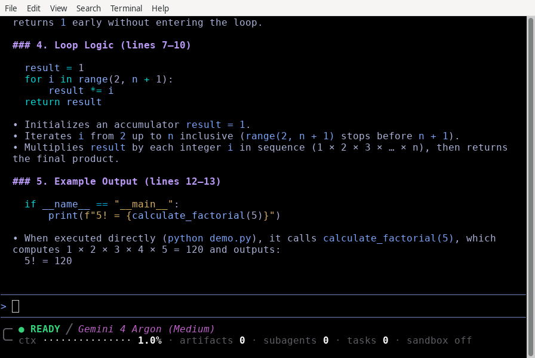

# Status line customization

Available on: Antigravity CLI

Define custom scripting configurations and format dynamic JSON state payloads to customize your TUI status line.

Note

To toggle the status line on or off or configure it from the TUI, refer to the **[Status line command](./commands/statusline.md)**.

## Overview

The status line is positioned at the bottom of the TUI prompt panel. It provides at-a-glance context regarding active agent cycles, workspace environments, context token window usages, and background execution tasks.

## Custom status line scripting

For advanced terminal layouts or custom status bar displays, you can route active agent metadata into a custom script.

### Configuration

Add a `statusLine` configuration block to your `~/.gemini/antigravity-cli/settings.json` file:

```json
{
    "statusLine": {
        "type": "command",
        "command": "~/.gemini/antigravity-cli/statusline.sh"
    }
}
```

Whenever the agent state changes, the CLI runs your command with `sh -c` (`cmd /c` on Windows), pipes the session state as JSON to its `stdin`, and shows what the command prints to `stdout` in the status line. Multi-line output and ANSI color codes are supported, and a leading `~` in `command` expands to your home directory.

The `statusLine` block accepts these properties:

*   **`command`** (string): Shell command that prints the status line.
*   **`type`** (string, default `"command"`): Optional. `"command"` is the only supported type.
*   **`padding`** (integer, default `0`): Number of blank lines above the status line.
*   **`enabled`** (boolean, default `true`): Set to `false` to stop running `command` and show the built-in status line instead. The command stays in `settings.json`.
*   **`stack_with_default`** (boolean, default `false`): When `true`, shows your status line below the built-in one instead of replacing it.

Set `statusLine` to an object, not to `true` or `false`. The CLI reads a boolean as an object without a `command`, so no script runs.

Note

The CLI runs your script at most once every 300 ms and stops any run that takes longer than 5 seconds. After 30 failed runs in a row, it stops running the script for the rest of the session and shows `⚠ Statusline disabled after 30 consecutive failures.` Run `/statusline enable` to try again, or `/statusline delete` to remove the command.

### Available JSON fields

The JSON payload piped to your script contains the following top-level fields:

| Field | Type | Description |
| :-- | :-- | :-- |
| `cwd` | string | Directory the CLI was started in. |
| `session_id` | string | Same value as `conversation_id`, kept for compatibility. |
| `conversation_id` | string | ID of the active conversation (empty before the first one starts). |
| `conversation_title` | string | Title of the active conversation (omitted until it has one). |
| `transcript_path` | string | Path where the conversation transcript is written (the file may not exist yet). |
| `model` | object | Contains `id`, `display_name`, and `effort` (`low` through `max`, only for models with several effort levels). `null` until a model is selected. |
| `workspace` | object | Contains `current_dir` and `project_dir` paths. |
| `version` | string | CLI version string. |
| `context_window` | object | Contains token usage details: `total_input_tokens`, `total_output_tokens`, `context_window_size` (`0` if unknown), `used_percentage`, `remaining_percentage`, and `current_usage` (`null` before the first model response). |
| `exceeds_200k_tokens` | bool | True if the conversation context has exceeded 200,000 tokens (`null` before the first model response). |
| `agent` | object | Contains the `name` of the active agent (omitted for the default agent). |
| `product` | string | Application name (`antigravity`). |
| `quota` | object | Maps quota bucket IDs to their status: `remaining_fraction` or `remaining_amount`, `reset_time`, `reset_in_seconds`, and `disabled` (optional). |
| `agent_state` | string | Current state: `idle`, `working`, `tool_use`, `reviewing`, `authenticating`, `initializing`, or `error`. |
| `vcs` | object | Version control `type`: `git`, `jj`, or `hg` (omitted outside a repository). |
| `cycle_mode` | string | Mode selected with Shift + Tab: `accept-edits`, `auto`, or `plan` (omitted in the default mode). |
| `sandbox` | object | Contains `enabled`, which is `true` while the terminal sandbox is on. |
| `subagents` | array | Running and finished subagents, each with `name`, `role`, and `status` (`running` or `completed`). |
| `artifact_count` | int | Number of artifacts produced in the conversation (omitted when 0). |
| `plan_tier` | string | Subscription tier of the authenticated user (optional). |
| `email` | string | Email address of the signed-in account. |
| `pending_input_count` | int | Number of queued user messages (omitted when 0). |
| `tool_confirmation_pending` | bool | True when a tool confirmation dialog is showing (omitted otherwise). |
| `task_count` | int | Number of running background tasks (omitted when 0). |
| `terminal_width` | int | Live width of the interactive terminal. |
| `vim` | object | Vim editing state: `mode` is `NORMAL`, `INSERT`, `VISUAL`, or `VISUAL LINE`. Present only when [Vim editor mode](./vim-editor-mode.md) is enabled. |
| `cost` | object | Estimated spend in US dollars: `total_usd` (including subagents), `subagent_usd`, and `estimated`. These are estimates based on list prices, not billed amounts (omitted until a cost is reported). |

### JSON payload example

Here is a sanitized, typical JSON payload piped to your status line script:

```json
{
    "cwd": "/home/user/my-project",
    "session_id": "12345678-abcd-ef01-2345-6789abcdef01",
    "conversation_id": "12345678-abcd-ef01-2345-6789abcdef01",
    "transcript_path": "/home/user/.gemini/antigravity/brain/12345678-abcd-ef01-2345-6789abcdef01/.system_generated/logs/transcript.jsonl",
    "conversation_title": "Explain the factorial function",
    "model": {
        "id": "Gemini 4 Argon (Medium)",
        "display_name": "Gemini 4 Argon (Medium)",
        "effort": "medium"
    },
    "workspace": {
        "current_dir": "/home/user/my-project",
        "project_dir": "/home/user/my-project"
    },
    "version": "1.4.5",
    "context_window": {
        "total_input_tokens": 88244,
        "total_output_tokens": 61074,
        "context_window_size": 1048576,
        "used_percentage": 14.24,
        "remaining_percentage": 85.76,
        "current_usage": {
            "input_tokens": 63382,
            "output_tokens": 346,
            "cache_creation_input_tokens": 0,
            "cache_read_input_tokens": 20857
        }
    },
    "exceeds_200k_tokens": false,
    "product": "antigravity",
    "quota": {
        "gemini-weekly": {
            "remaining_fraction": 0.9378,
            "reset_time": "2026-07-06T07:50:32Z",
            "reset_in_seconds": 560580
        }
    },
    "agent_state": "idle",
    "vcs": {
        "type": "git"
    },
    "cycle_mode": "plan",
    "sandbox": {
        "enabled": false
    },
    "artifact_count": 2,
    "plan_tier": "Pro",
    "email": "developer@example.com",
    "task_count": 1,
    "terminal_width": 111,
    "cost": {
        "total_usd": 0.4213,
        "subagent_usd": 0,
        "estimated": false
    }
}
```

### Example script

You can download a complete, layout-adaptive script from the official [statusline.sh example on GitHub](https://github.com/google-antigravity/antigravity-cli/blob/main/examples/statusline/statusline.sh). This script shows the agent state, the model, a context window usage bar, and counts of artifacts, subagents, and background tasks.

Save the script to `~/.gemini/antigravity-cli/statusline.sh` and make it executable:

```bash
chmod +x ~/.gemini/antigravity-cli/statusline.sh
```

With the script configured, your status line replaces the built-in one below the prompt box:



## See also

Explore the following guides to customize other CLI elements:

*   **[Status line command](./commands/statusline.md)**: Toggle status line elements interactively.
*   **[Terminal title customization](./title.md)**: Configure dynamic window titles.
*   **[Settings, rendering, and keybindings](https://antigravity.google/docs/settings?tab=cli)**: Customize keyboard hotkeys and buffers, and see every `statusLine` property.
*   **[CLI reference](./reference.md)**: Quick reference for slash commands, keybindings, and configuration keys.
*   **[Permissions and sandbox](https://antigravity.google/docs/sandbox?tab=cli)**: Manage secure directory permissions.